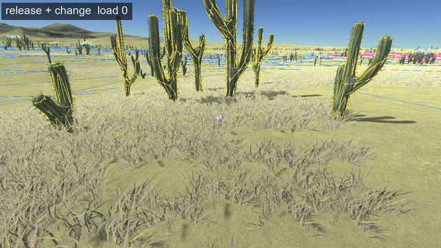

# Non-regression tests: the colliders on the scatter

Part of [Scatter rotation](../README.md), one chapter of [Non-regression tests](../non-regression.md): with the change, the colliders Parallax gives the scatter near a craft stay on the objects drawn, load after load, on the Mun, on Eve and on Kerbin.

**If the change broke it**: the colliders Parallax gives the scatter near a craft would no longer be where
the scatter is drawn. A craft would hit a rock where none is drawn, or go through one that is, or stand
on nothing.

**Why**: the scatter is drawn by a compute shader, and its colliders are made by the C# code of Parallax
Continued (`CollisionManager`). The change builds the orientation of each object in the frame of its
terrain quad on both sides ([The change](../the-change.md)): if the two did not give the same orientation,
the collider would part from the object drawn.

**Release + change only.** Without the change, the scatter turns at every load
([Reproducing the bug](../reproducing-the-bug.md)), the colliders with it: a kerbal saved in the middle of a
cluster would come back away from it, or inside it. The test means nothing there.

**The install**: [the install](../README.md#the-builds-and-the-install) with the **release + change** build,
[KSP Diag - Colliders](https://github.com/lhervier/KSP-Diag-Colliders) and
[KSP Diag - Floating Origin](https://github.com/lhervier/KSP-Diag-FloatingOrigin). Diag Colliders
outlines in colour the collider of every object of the scatter Parallax gives one: it does so only near
a craft, within the size of the craft plus the size of the object.

**By hand**: the steps of [The rocks turn at every load](../reproducing-the-bug.md#the-rocks-turn-at-every-load),
from a save where the kerbal stands in the middle of the scatter, close enough for its objects to get
colliders, and with a view from the side rather than from above, so that the outlines show on the
objects. At every load, each outline is on an object drawn, and stays on it. On three bodies:

- **the Mun**, [`colliders-mun.sfs`](../saves/colliders-mun.sfs): among rocks, all laid on the slope of the
  ground;
- **Eve**, [`colliders-eve.sfs`](../saves/colliders-eve.sfs): among flat rocks, with colliders, and red
  plants, which have none (`collisionLevel = 0` in their config): no outline on them;
- **Kerbin**, [`colliders-kerbin.sfs`](../saves/colliders-kerbin.sfs): in a cluster of cacti, which stand
  along the radius of the body; on Kerbin, ten minutes of time warp before each load rather than an hour
  (Kerbin turns by 60.1° in an hour, [The rocks turn at every load](../reproducing-the-bug.md#the-rocks-turn-at-every-load)).

The colours of the outlines can change from one load to the next: Diag Colliders gives a colour to each
scatter in the order it meets them, and that order is not the same at every load. Only where an outline
is matters.

**Script**: [`automation/run-rocks-turning.py`](../automation/run-rocks-turning.py), with the view from the
side:

| body | arguments |
|---|---|
| Mun | `--save colliders-mun --distance 12 --heading 0 --pitch 25` |
| Eve | `--save colliders-eve --radius 700000 --distance 15 --heading 200 --pitch 30` |
| Kerbin | `--save colliders-kerbin --radius 600000 --step 600 --distance 15 --heading 180 --pitch 20` |

**Result**: played by the script on [the install](../README.md#the-builds-and-the-install), with the
release + change build, twelve loads each; the Mun turned by 112.4° in the scene, Eve by 194°, Kerbin by
123.4°. **On every screenshot, every outline is on the object it belongs to**: the rocks of the Mun and of
Eve, each cactus of the cluster of Kerbin; none moves from one load to the next, and the plants of Eve
have none. The kerbal stays `LANDED` where the save left him, within 10 mm.

| body | animation (one load a second) | run |
|---|---|---|
| Mun | [GIF](../runs/colliders-mun/colliders-mun-change.gif), [MP4](../runs/colliders-mun/colliders-mun-change.mp4) | [`colliders-mun/`](../runs/colliders-mun/) |
| Eve | [GIF](../runs/colliders-eve/colliders-eve-change.gif), [MP4](../runs/colliders-eve/colliders-eve-change.mp4) | [`colliders-eve/`](../runs/colliders-eve/) |
| Kerbin | [GIF](../runs/colliders-kerbin/colliders-kerbin-change.gif), [MP4](../runs/colliders-kerbin/colliders-kerbin-change.mp4) | [`colliders-kerbin/`](../runs/colliders-kerbin/) |

*Kerbin, release + change: the kerbal in the middle of a cluster of cacti, each cactus outlined by its
collider.*

Each folder holds the screenshots (`load-NN` after each load, `warp-NN` before it), the line of KSP
Diag - Floating Origin at each of them (`readings.json`), what the script printed (`output.txt`) and the
`KSP.log` of the session, the same for the three bodies, played one after the other.
