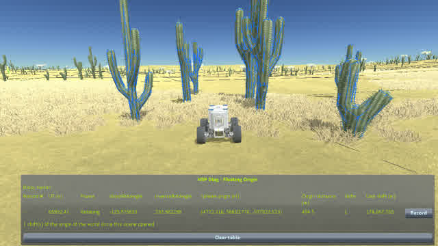
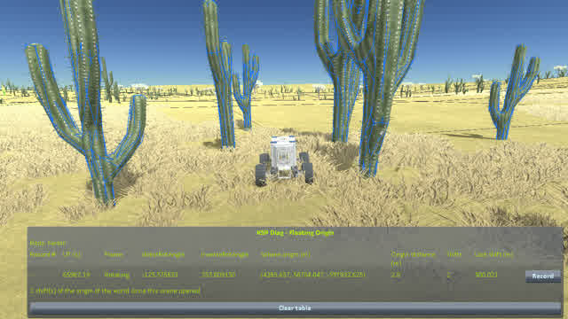

# Non-regression tests: when the floating origin moves

Part of [Scatter rotation](../README.md), one chapter of [Non-regression tests](../non-regression.md): with the change, when KSP moves the floating origin, the cacti of Kerbin and their colliders stay together.

**If the change broke it**: right after KSP moves the floating origin, the scatter drawn and its colliders
would no longer be at the same place. A craft would hit a cactus where none is drawn, or go through one
that is.

**Why**: KSP moves the whole world back to the origin when the active craft goes 500 m from it. The
colliders are children of their terrain quads, and move with them. The scatter drawn is placed from the
quad's matrix at every frame, and the change uses that matrix for the orientation too
([The change](../the-change.md)).

**Release + change only.** Without the change, the scatter turns at every load
([Reproducing the bug](../reproducing-the-bug.md)), and the colliders with it: the cluster the rover drives
to would not be where the save expects it, nor the path to it free of cacti. The test means nothing there.

**Kerbin only.** A rover has to drive 500 m in a straight line, on its own, and stop among objects that
have colliders. The flat desert of Kerbin and its clusters of cacti allow it; the ground of the Mun and of
Eve, among rocks, is too rough for it.

**The install**: [the install](../README.md#the-builds-and-the-install) with the **release + change** build,
[KSP Diag - Colliders](https://github.com/lhervier/KSP-Diag-Colliders) and
[KSP Diag - Floating Origin](https://github.com/lhervier/KSP-Diag-FloatingOrigin). Diag Colliders
outlines in colour the collider of every object of the scatter Parallax gives one: it does so only near
a craft, within the size of the craft plus the size of the object, so the rover has to be in the cluster.
Diag Floating Origin shows how far the craft is from the floating origin, how many times KSP moved it since
the scene opened, and the length of the last move.

**By hand**, from [`floating-origin-kerbin.sfs`](../saves/floating-origin-kerbin.sfs): a rover alone in the
desert of Kerbin, 503 m from the middle of a cluster of cacti, facing it, with nothing in between.

1. Load the save. Loading puts the floating origin on the rover: Diag Floating Origin shows an origin
   distance of 0.0 m.
2. Drive straight to the cluster, and stop about 8 m short of its middle: the cacti next to the rover are
   outlined in colour, and Diag Floating Origin shows an origin distance under 500 m, with no new shift.
3. Drive on, slowly, to the middle of the cluster. At 500 m, KSP moves the origin: Diag Floating Origin
   counts one more shift, of 500 m, and the origin distance drops to a few metres.
4. Look at the cacti next to the rover: each outline is still on its cactus.

**Script**: [`automation/run-floating-origin.py`](../automation/run-floating-origin.py), with its defaults:

    python run-floating-origin.py --folder <your sandbox game> --save floating-origin-kerbin --out out

It drives the rover with `drive_to` to the middle of the cluster, whose latitude and longitude are its
defaults, in two legs: at 4 m/s up to 8 m short of it, then at 1 m/s. It takes a screenshot at the end of
each leg, from 15 m behind the rover, with the window of Diag Floating Origin alone at the bottom of the
screen, and stops if the origin moved before the first stop, or did not move once on the second leg.

**Result**: played by the script on [the install](../README.md#the-builds-and-the-install), with the
release + change build. Before the shift, the rover stands 494.5 m from the origin, and the cacti next to
it are outlined. After it, Diag Floating Origin counts one more shift, of 500.021 m, the rover stands
2.8 m from the new origin, and **every outline is still on its cactus**.

| before the shift | after the shift |
|---|---|
|  |  |

The run is in [`floating-origin-kerbin/`](../runs/floating-origin-kerbin/): the two screenshots, the line
of Diag Floating Origin and the colliders listed by Diag Colliders at the load and at each stop
(`readings.json`), what the script printed (`output.txt`) and the `KSP.log` of the session.
