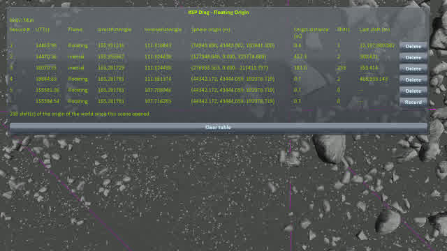
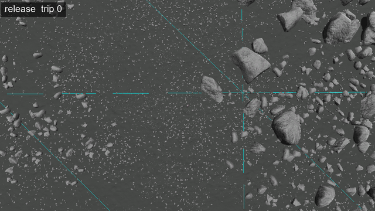
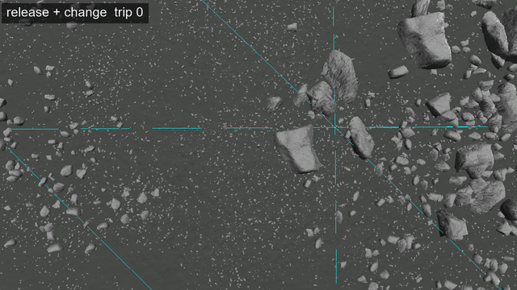

# Non-regression tests: when the frame changes

Part of [Scatter rotation](../README.md), one chapter of [Non-regression tests](../non-regression.md): with the change, a craft that goes above the rotating-frame altitude and comes back finds the rocks of the Mun as it left them, and their colliders on them.

**If the change broke it**: after the craft comes back below the rotating-frame altitude, the rocks
would have turned, or their colliders would part from the rocks drawn.

**Why**: below its rotating-frame altitude (100 km on the Mun), KSP holds the body still in the scene;
above it, the body turns in the scene. When the craft comes back down, KSP holds the body still again,
at the angle it has reached, without loading anything (`OrbitPhysicsManager.checkReferenceFrame`, which
writes `Reference Frame: Rotating` in `KSP.log` when it does). Without the change, the orientation of
each object of the scatter follows the angle the body is turned by in the scene
([The change](../the-change.md)): back on the ground, every cluster has turned on itself by the angle the
body turned while the craft was above, as it does at a load ([Reproducing the bug](../reproducing-the-bug.md)).

**Played on both builds**: on the release, the test shows the bug through this other door; on the
release + change, that nothing turns.

**The install**: [the install](../README.md#the-builds-and-the-install), on each build, with
[KSP Diag - Colliders](https://github.com/lhervier/KSP-Diag-Colliders) and
[KSP Diag - Floating Origin](https://github.com/lhervier/KSP-Diag-FloatingOrigin). Diag Floating Origin
shows the frame (`Rotating` or `Inertial`) and `directRotAngle`, the angle the body is turned by in the
scene. Diag Colliders draws the edges of the terrain quads, a mark fixed to the ground, and outlines in
colour the collider of every rock near a craft.

**By hand**, a few minutes a trip, from [`rocks-mun-jeb.sfs`](../saves/rocks-mun-jeb.sfs): Jebediah
Kerman on EVA, standing on flat ground of the Mun at latitude −12.4106°, longitude 91.7384°, a few metres
from the nearest rocks.

1. Load the save. Press *Record* in the window of Diag Floating Origin: the frame is `Rotating`. Look at
   the kerbal from straight above, from some 40 m, and take a screenshot, as in
   [The rocks turn at every load](../reproducing-the-bug.md#the-rocks-turn-at-every-load).
2. With *Set Orbit* of the `Alt+F12` menu, put the kerbal on a circular orbit of the Mun 150 km high.
   Press *Record*: the frame is `Inertial`.
3. Let an hour of game time go by: time warp on rails. Press *Record*: `directRotAngle` has moved by
   9.3°, the angle the Mun turns in an hour.
4. With *Set Position* of the `Alt+F12` menu, put the kerbal back where the save left him: the latitude
   and the longitude above, altitude 1 m. Let him settle, and press *Record*: the frame is `Rotating`
   again, and `directRotAngle` stays where step 3 left it.
5. Time warp on the ground to the same time of day as step 1: a solar day of the Mun (141,115 s) after
   it. The frame stays `Rotating`, and `directRotAngle` does not move. Take the same screenshot: the Sun
   is where it was, and so are the shadows.
6. Steps 2 to 5 again.

With the release, at step 5, every cluster of rocks has turned on itself, around its own centre, while
the ground, the edges of the quads and the kerbal have not. With the release + change, every rock is where
it was at step 1, turned the same way.

**The colliders**: the same steps from [`colliders-mun.sfs`](../saves/colliders-mun.sfs), the kerbal in
the middle of rocks close enough to get colliders, and a view from the side
([The colliders on the scatter](the-colliders-on-the-scatter.md)), with the release + change only: at
every step 5, each outline is on a rock drawn, and stays on it.

**Script**: [`automation/run-frame-change.py`](../automation/run-frame-change.py). Steps 2 to 5, twelve
times over, with the line of Diag Floating Origin at each step and a screenshot at each step 5, by
`set_orbit`, `warp_to` and `set_position`. It stops if the frame is not `Inertial` in orbit or `Rotating`
on the ground, if a warp did not move the time on, or if the kerbal does not land back within 0.5 m of
where the save left him. After the first trip, it also takes the window of Diag Floating Origin, its
table holding the lines of that trip.

| run | arguments |
|---|---|
| rocks from above | `--save rocks-mun-jeb` |
| colliders | `--save colliders-mun --distance 12 --heading 0 --pitch 25` |

**Result**: played by the script on [the install](../README.md#the-builds-and-the-install), twelve trips
each; the Mun turned by 112.0° in the scene. At every trip, the frame goes `Inertial` in orbit and back to
`Rotating` on the ground, and `directRotAngle` moves by 9.33° while the kerbal is above, and not at all
while he is on the ground; `KSP.log` holds thirteen `Reference Frame: Rotating`, one for the load and
one for each trip. The kerbal lands back `LANDED` within 6 cm of where the save left him, and
every screenshot is taken at the same time of day.

*The first trip, in the table of Diag Floating Origin (release): `directRotAngle` moves only while the
frame is `Inertial`.*

- **Release**: at every trip, each cluster of rocks turns on itself, as at a load.
- **Release + change**: every rock is where it was before the first trip, turned the same way, trip
  after trip. Only the fine shading of the ground and of the rocks changes by a few levels of grey, as
  from one load to the next ([With the change, the rocks hold still](../reproducing-the-bug.md#with-the-change-the-rocks-hold-still)).
- **The colliders**, release + change: on every screenshot, every outline is on the rock it belongs to,
  and none moves from one trip to the next. Their colours can change from one trip to the next: Diag
  Colliders gives a colour to each scatter in the order it meets them.

| run | animation (one trip a second) | folder |
|---|---|---|
| rocks, release | [GIF](../runs/frame-mun/release/frame-mun-release.gif), [MP4](../runs/frame-mun/release/frame-mun-release.mp4) | [`frame-mun/release/`](../runs/frame-mun/release/) |
| rocks, release + change | [GIF](../runs/frame-mun/change/frame-mun-change.gif), [MP4](../runs/frame-mun/change/frame-mun-change.mp4) | [`frame-mun/change/`](../runs/frame-mun/change/) |
| colliders, release + change | [GIF](../runs/frame-colliders-mun/frame-colliders-mun-change.gif), [MP4](../runs/frame-colliders-mun/frame-colliders-mun-change.mp4) | [`frame-colliders-mun/`](../runs/frame-colliders-mun/) |

*The release: the screenshot of step 1, then the one of step 5 after each of twelve trips, one a second;
nothing was loaded.*

*Release + change: the same screenshots.*

Each folder holds the screenshots (`trip-NN` at each step 5, `table-01` after the first trip), the line
of Diag Floating Origin at each step (`readings.json`: `up-NN` in orbit, `orbit-NN` after the hour of time
warp, `down-NN` back on the ground, `trip-NN` a solar day after the screenshot before), what the script
printed (`output.txt`) and the `KSP.log` of the session. Each `KSP.log` holds three
`NullReferenceException` in `PQS.UpdateEdges`, stock code, right after the kerbal is put back on the
ground at the first three trips: on the release as with the change.

**A change of sphere of influence** brings nothing more, as read in the code of KSP: it changes the body
the frame is tied to (`OrbitPhysicsManager.setDominantBody`), not the frame, and it happens thousands of
kilometres above the rotating-frame altitude, where the body already turns in the scene. What counts is
the craft coming back below that altitude, the switch this test plays. **The other bodies** go through
the same switch, at their own altitude: the Mun stands for them.
