# Reproducing the bug

Part of [Scatter rotation](README.md): the protocol that shows the bug on Parallax Continued 1.0.4, the
rocks seen from above around a kerbal standing a few metres from them, played by hand and by a script,
on the Mun, on Eve, and on Kerbin with a cluster of cacti that stand along the radius of the body;
the same protocol with the change, where the rocks and the cacti hold still; near the south pole of a
body, a second defect, where the collider of an object is turned around it otherwise than the object
drawn, and the same protocol with the change; what still changes from one load to the next, with the
change as without it, and does not come from this bug: the texture of the ground, and a plant on Eve;
then what the bug does to a craft standing on a rock.

## The rocks turn at every load

**The install**: [the install](README.md#the-builds-and-the-install) with the **release** build,
[KSP Diag - Colliders](https://github.com/lhervier/KSP-Diag-Colliders) and
[KSP Diag - Floating Origin](https://github.com/lhervier/KSP-Diag-FloatingOrigin). Diag Colliders is only
there to give the screenshots a mark fixed to the ground: it draws the collider of every terrain quad
within 300 m, each quad in its own colour, so the edges of the quads meet in a cross at each vertex. It
would also draw the colliders Parallax gives the rocks near a craft, but a kerbal a few metres from the
nearest rock gets none. Diag Floating Origin shows `directRotAngle`, the angle the Mun is turned by in
the scene. `Alt+F6` hides both windows; the drawing goes on.

**By hand**, about fifteen minutes:

1. Copy [`rocks-mun-jeb.sfs`](saves/rocks-mun-jeb.sfs) into the folder of a sandbox game and load it:
   Jebediah Kerman on EVA, standing on flat ground of the Mun, a few metres from a vertex of the terrain
   quads and from the nearest rocks. Any craft standing still among rocks will do.
2. Press *Record* in the window of Diag Floating Origin. Look at the kerbal from straight above, from
   some 40 m, and take a screenshot. Near the kerbal, the edges of the quads meet in a cross: they are fixed to
   the ground, and tell that the view did not move nor turn from one screenshot to the next. The camera
   follows the kerbal, and a kerbal who moved would move the whole picture; its heading is counted from
   north, so the kerbal turning on himself does not turn the picture.
3. Let an hour of game time go by without loading anything: time warp ×100 on rails for about 36
   seconds. Take a screenshot again: nothing has moved, and `directRotAngle` has not changed.
4. Load **the same save** again, not a new one. Press *Record*, take the same screenshot: every cluster
   of rocks has turned on itself, around its own centre, while the ground, the quad edges and the kerbal
   have not. `directRotAngle` has moved by the angle the Mun turns in an hour.
5. Repeat steps 3 and 4: at each load the rocks turn a little further, by the same angle as
   `directRotAngle`.

The Mun turns once in 138,984 s: 9.3° for an hour of game time, 1.6° for ten minutes played in real time.
Saving and loading straight away turns nothing, and neither does time going by while nothing is loaded:
only loading an older save does, or starting KSP again, or a craft going above the rotating-frame altitude
and back (see [The change](the-change.md#why-the-rocks-turn)).

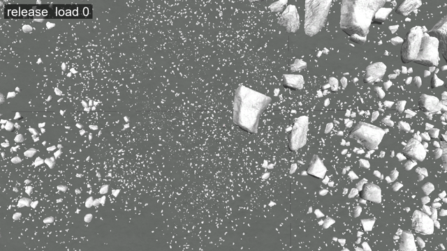

*The release: the screenshot of step 2, then the one of step 4 after each of twelve loads, one a second;
the Mun turned by 112° in the scene in all. The kerbal is the red dot at the centre. Full size:
[MP4](runs/rocks-mun-jeb/release/rocks-mun-jeb-release.mp4).*

**On Eve**, with [`rocks-eve-jeb.sfs`](saves/rocks-eve-jeb.sfs): the same kerbal, standing a few metres
from rocks and from vegetation, which has no collider. Eve turns once in 80,500 s, 16.1° for an hour of
game time. At each load the rocks and the plants turn, each on itself.

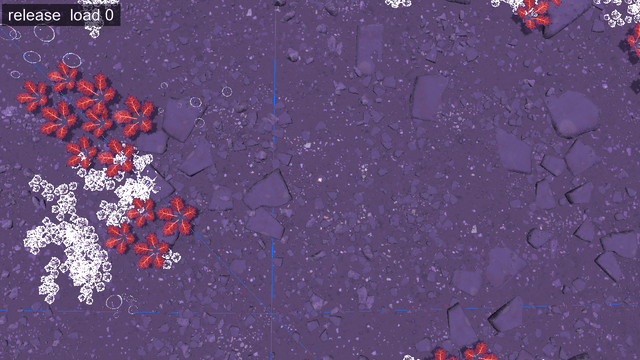

*The release on Eve: the same screenshots, Eve turned by 194° in the scene in all; the save is made at
noon where the kerbal stands. Full size: [MP4](runs/rocks-eve-jeb/release/rocks-eve-jeb-release.mp4). Small pebbles
that seem to come and go, and a white plant that shows on some loads only, do not come from this bug:
[What changes at every load all the same](#what-changes-at-every-load-all-the-same).*

**On Kerbin**, with [`cacti-kerbin.sfs`](saves/cacti-kerbin.sfs): the same kerbal in the desert, some
40 m from a cluster of cacti. The rocks of the Mun and of Eve are laid on the slope of the ground; the
trees, the cacti and the icebergs of Kerbin, among others, stand along the radius of the body
(`alignToTerrainNormal = False` in their config), the other way the code orients an object, and the bug
turns them too. A cluster of cacti (`LargeCactiCluster`, `MedCactiCluster`, `SmallCactiCluster`) is
drawn as one object, and turns on itself as plainly as a cluster of rocks. Kerbin turns once in
21,549 s, 60.1° for an hour of game time: at step 3, ten minutes of time warp rather than an hour, 10°
at each load, near the 9.3° of the Mun. At 60° a load, the cluster is seen to move, not to turn.

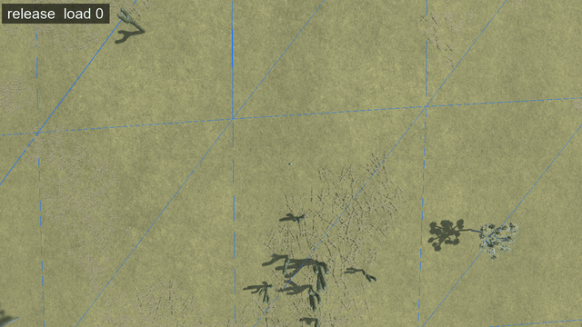

*The release on Kerbin: the same screenshots, ten minutes of time warp before each load, Kerbin turned by
123.4° in the scene in all; the cluster of cacti is at the bottom. Full size:
[MP4](runs/cacti-kerbin/release/cacti-kerbin-release.mp4). The texture of the ground slides at every
load, as on Eve: [What changes at every load all the same](#what-changes-at-every-load-all-the-same).*

**By script**: [`automation/run-rocks-turning.py`](automation/run-rocks-turning.py). Steps 1 to 5,
twelve times over, with a screenshot before and after each load and the line of Diag Floating Origin at
each of them; it stops if the warp did not move the time on, or if the kerbal moved after a load. On Eve:
`--save rocks-eve-jeb --radius 700000`; on Kerbin: `--save cacti-kerbin --radius 600000 --step 600
--distance 80`. The screenshots are the result: the runs are in
[`runs/rocks-mun-jeb/`](runs/rocks-mun-jeb/), [`runs/rocks-eve-jeb/`](runs/rocks-eve-jeb/) and
[`runs/cacti-kerbin/`](runs/cacti-kerbin/), each with a `release/` and a `change/` folder: the
screenshots (`load-NN` after each load, `warp-NN` before it), the line of Diag Floating Origin at each of
them (`readings.json`), what the script printed (`output.txt`) and the `KSP.log` of the session. On every
run, the time warp alone turns nothing (`warp-NN` against `load-NN` before it), and the kerbal stays
`LANDED` where the save left him, within 6 mm.

## With the change, the rocks hold still

**The install**: the same, with the **release + change** build
([The builds and the install](README.md#the-builds-and-the-install)). **The saves**: the same,
[`rocks-mun-jeb.sfs`](saves/rocks-mun-jeb.sfs), [`rocks-eve-jeb.sfs`](saves/rocks-eve-jeb.sfs) and
[`cacti-kerbin.sfs`](saves/cacti-kerbin.sfs).

Play the steps of [The rocks turn at every load](#the-rocks-turn-at-every-load) again. At step 4, and at
every load after it, `directRotAngle` moves as before, by the angle the Mun turns in an hour: KSP still
turns the Mun in the scene at each load. The rocks no longer follow it: every cluster is where it was at
step 2, turned the same way, load after load; on Eve, the plants as well; on Kerbin, the cluster of
cacti, none of them leaning. Only the fine shading of the ground and of the rocks changes
by a few levels of grey from one screenshot to the next.

The first screenshot does not show the rocks as the release does: the change gives every rock another
orientation, tied to its terrain quad, once, and keeps it at every load after
([What the change does](the-change.md#what-the-change-does)).

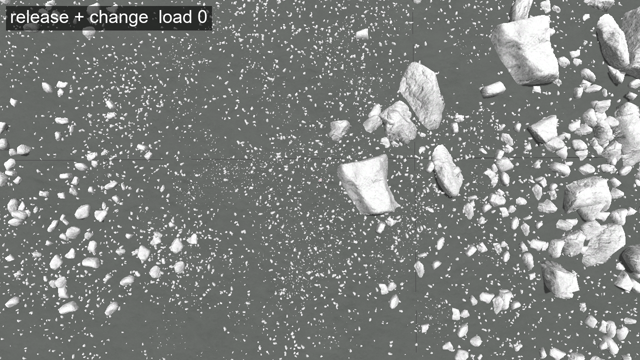

*Release + change: the same screenshots as above, from the same save, the Mun turned by 112° in the scene
in all. Full size: [MP4](runs/rocks-mun-jeb/change/rocks-mun-jeb-change.mp4).*

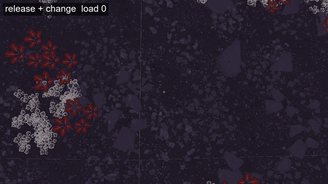

*Release + change on Eve, Eve turned by 194° in the scene in all. Full size:
[MP4](runs/rocks-eve-jeb/change/rocks-eve-jeb-change.mp4). The small pebbles that seem to come and go,
and the white plant that shows on some loads only, are there without the change too:
[What changes at every load all the same](#what-changes-at-every-load-all-the-same).*

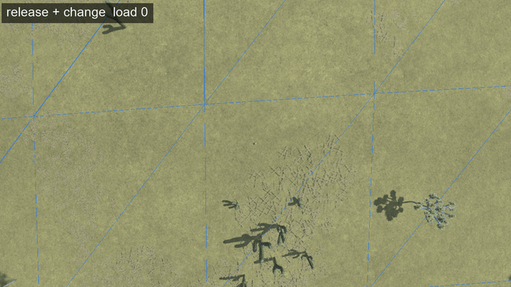

*Release + change on Kerbin, Kerbin turned by 123.4° in the scene in all. Full size:
[MP4](runs/cacti-kerbin/change/cacti-kerbin-change.mp4). The texture of the ground slides at every load,
as with the release: [What changes at every load all the same](#what-changes-at-every-load-all-the-same).*

**By script**: the same script, KSP started with the release + change build. The runs are in the
`change/` folder next to each `release/` one.

## Near the south pole, the colliders part from the objects drawn

A second defect, which these tests came across near the south pole of Laythe: there, the collider
Parallax gives an object is turned around the object otherwise than the object drawn. It is in the
release; the change, which builds the orientation in another frame, has to deal with it too
([The second commit](the-change.md#the-second-commit-near-the-south-pole)).

**Where.** An object that stands along the radius of the body (`alignToTerrainNormal = False`) takes
the normal of its terrain quad: the direction from the centre of the body to the centre of the quad, the
same for every object of that quad. At a pole of a body, four terrain quads of the finest level meet.
On Laythe, as on Kerbin, that level is 10 (Diag Colliders lists the level of each quad it draws), and
the centre of each of the four quads is √2 / 2¹⁰ radian from the pole: their normal points 0.0796° from
the axis of the body. At the south pole, that is 0.0796° from straight down the `up` axis from which
Parallax orients every object. The trees of Laythe stand along the radius, and have colliders
(`Trees` in `Laythe.cfg` of the stock scatter textures).

**Why.** The compute shader and the colliders do not orient an object with the same code. The compute
shader turns `up` onto the normal around the axis `up × normal` (`TransformToPlanetNormal`). The
colliders call `Quaternion.FromToRotation(Vector3.up, normal)`, and that close to straight down, Unity
no longer turns around that axis. [`automation/FromToRotationNearDown.cs`](automation/FromToRotationNearDown.cs),
an editor script for Unity 2019.4.18f1, the version of KSP 1.12.5, writes what it returns for normals
that lean the same way, closer and closer to straight down:

| angle from straight down | rotation returned (x, y, z, w) | axis |
|---|---|---|
| 0.5° | (0.7071, 0, −0.7071, 0.0044) | (0.7071, 0, −0.7071), the axis `up × normal` |
| 0.1° | (0.7071, 0, −0.7071, 0.0009) | the same |
| **0.0796°** | **(1, 0, 0, 0)** | **X**, whatever way the normal leans |
| 0.05° | (1, 0, 0, 0) | X |

Below about 0.08°, Unity makes half a turn around X; it then sends `up` 0.08° away from the normal,
which does not show, but it turns the object around the normal otherwise than the compute shader does:
by twice the angle between the two axes. For a quad whose centre lies diagonally from the pole, that
angle is 45°: the collider is turned by 90° around the trunk. On the release, the X of that half turn is
the axis of the scene, and the axis `up × normal` follows the body: the gap changes at every load, as
the body is turned again in the scene.

**The install**: [the install](README.md#the-builds-and-the-install) with the **release** build,
[KSP Diag - Colliders](https://github.com/lhervier/KSP-Diag-Colliders) and
[KSP Diag - Floating Origin](https://github.com/lhervier/KSP-Diag-FloatingOrigin). Diag Colliders
outlines in colour the collider of the tree next to the kerbal, and in other colours the colliders of
the four terrain quads, which meet at the pole.

**The save**: [`pole-laythe.sfs`](saves/pole-laythe.sfs), Jebediah Kerman on EVA on Laythe, some 440 m
from the south pole, next to a tree of one of the four quads.

**By hand**: the steps of [The rocks turn at every load](#the-rocks-turn-at-every-load), with a view of
the tree from the side, some 60 m away, rather than from above. At every load, the outline of the
collider is turned around the trunk from the tree drawn, and by another angle at each load. Laythe turns
once in 52,981 s, 24.5° for an hour of game time.

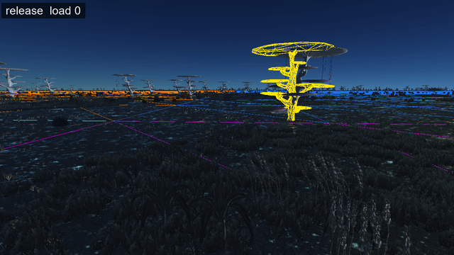

*The release near the south pole of Laythe, Laythe turned by 294.8° in the scene in all: the tree turns
at every load, as every object does on the release, and its collider does not follow it. Full size:
[MP4](runs/pole-laythe/release/pole-laythe-release.mp4).*

**With the change**, the same save and the same steps: the tree no longer turns, and the outline of its
collider is on it at every load.

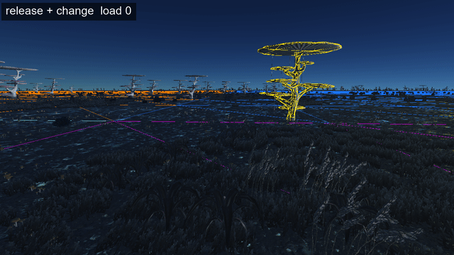

*Release + change near the south pole of Laythe, Laythe turned by 294.8° in the scene in all. Full size:
[MP4](runs/pole-laythe/change/pole-laythe-change.mp4).*

**By script**: [`automation/run-rocks-turning.py`](automation/run-rocks-turning.py) with
`--save pole-laythe --radius 500000 --distance 60 --heading 250 --pitch 10`, once with each build. The runs
are in [`runs/pole-laythe/`](runs/pole-laythe/), a `release/` and a `change/` folder, as for the rocks;
the kerbal stays `LANDED` where the save left him, within 2 mm.

## What changes at every load all the same

With the change, nothing turns any more. Two things still change from one load to the next, with the
change as with the release, even when the same save is loaded again at once, with no time played: the
texture of the ground, on every body, and, on Eve, a plant that shows on some loads only. Neither comes
from this bug, and the change does not touch them.

**The texture of the ground slides.** The terrain shader of Parallax Continued places the texture of
the ground from the position of each point in the Unity scene, `(worldPos + _TerrainShaderOffset) *
_Tiling` (`BiplanarFunctions.cginc`). KSP turns the body in the scene again at every load
([Why the rocks turn](the-change.md#why-the-rocks-turn)), so the same point of the ground comes back at
another place in the scene, and the texture comes back slid along the ground. Loading the same save again
straight away is enough: Eve turns by a few hundredths of a degree in the scene, and a point of its ground
moves by hundreds of metres in it. How it shows depends on the texture:

- on the Mun, only the fine shading of the ground changes;
- on Eve, light grains painted in the texture look like small pebbles coming and going (below);
- on Kerbin, the whole ground of the desert is seen sliding from one picture to the next, in the
  animations of [The rocks turn at every load](#the-rocks-turn-at-every-load) and
  [With the change, the rocks hold still](#with-the-change-the-rocks-hold-still): Kerbin turns by 10°
  between two of them, and a point of its ground moves by some 100 km in the scene.

It is the same kind of defect as the rocks that turn, a texture tied to the scene rather than to the
body, in the terrain shader, and only seen: the ground the physics uses does not move. It may deserve its
own change.

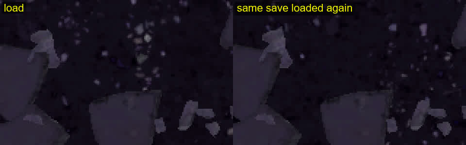

*Release + change on Eve, a view of 10 m from above around the kerbal, enlarged. To be sure the grains are
not objects, every scatter of Eve without a collider was taken out by a ModuleManager patch, and the
scatter of stock KSP switched off in the settings: what is left is the rocks with colliders, which do not
move, and the ground, whose grains change.*

**A plant shows on some loads, and not on others, already with the release.** In the grove at the left of
the view, a white plant under the red ones, at the bottom right, shows at one load and not at the next. It
does so on the release as well; there, it is harder to see, as the whole grove also turns.

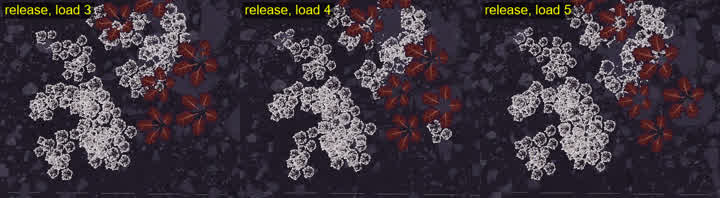

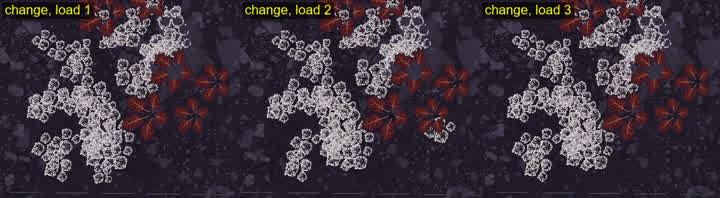

*Crops of the screenshots of an earlier run of Eve, from the same place at dusk, before its save was
moved to noon.*

**This plant follows the ground of stock KSP.** Parallax Continued decides where each object of its
scatter grows from the mesh of the terrain quad (`Distribute`), and stock KSP builds that mesh a little
differently at every load ([Why it is different at every load](https://github.com/lhervier/KSP-TerrainPrecisionFix/blob/main/docs/the-culprit-ground.md#why-it-is-different-at-every-load)):
a plant that sits right on one of the thresholds of `Distribute` grows at one load and not at the next.
With [KSP TerrainPrecisionFix](https://github.com/lhervier/KSP-TerrainPrecisionFix), which builds the
ground of stock KSP the same at every load, the same plants grow every time: shown there,
[Parallax: its scatter grows the same at every load](https://github.com/lhervier/KSP-TerrainPrecisionFix/blob/main/docs/non-regression/parallax/its-scatter-grows-the-same-at-every-load.md).

## What it does to a craft

A rock that has turned at a load is no longer where the save left it. A kerbal or a craft standing on
it, or right next to one, starts on another part of the rock, above it, or inside it, and the physics
engine throws a craft that starts inside a rock out: the behaviour reported to Parallax Continued in
[issue #125](https://github.com/Gameslinx/Parallax-Continued/issues/125), *Mun Surface Scatter
Devoured/Torn Apart Small Vessel Upon Game Relaunch*. In a game played normally, the save is loaded after
a restart of KSP, in a session that has not played the same time as the one the save was made in: the
rocks come back turned by any angle. A kerbal on a rock, loaded without the change and with it, is in
[Work in progress](work-in-progress.md#a-kerbal-on-a-rock).
